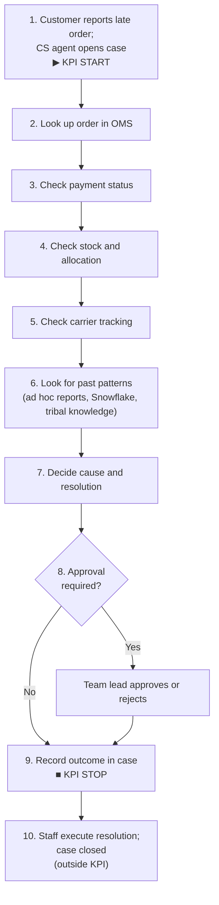
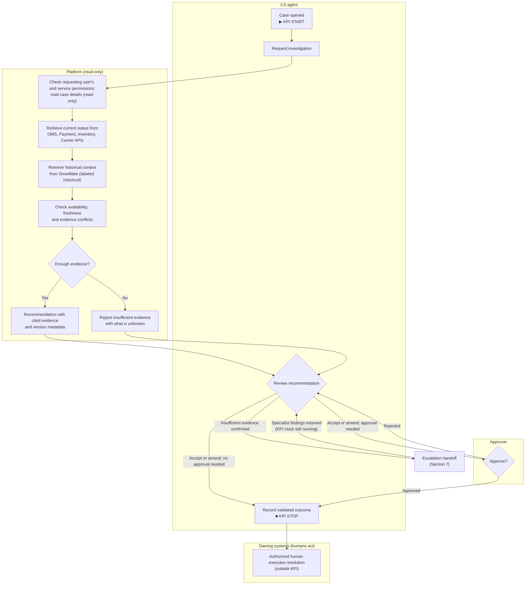
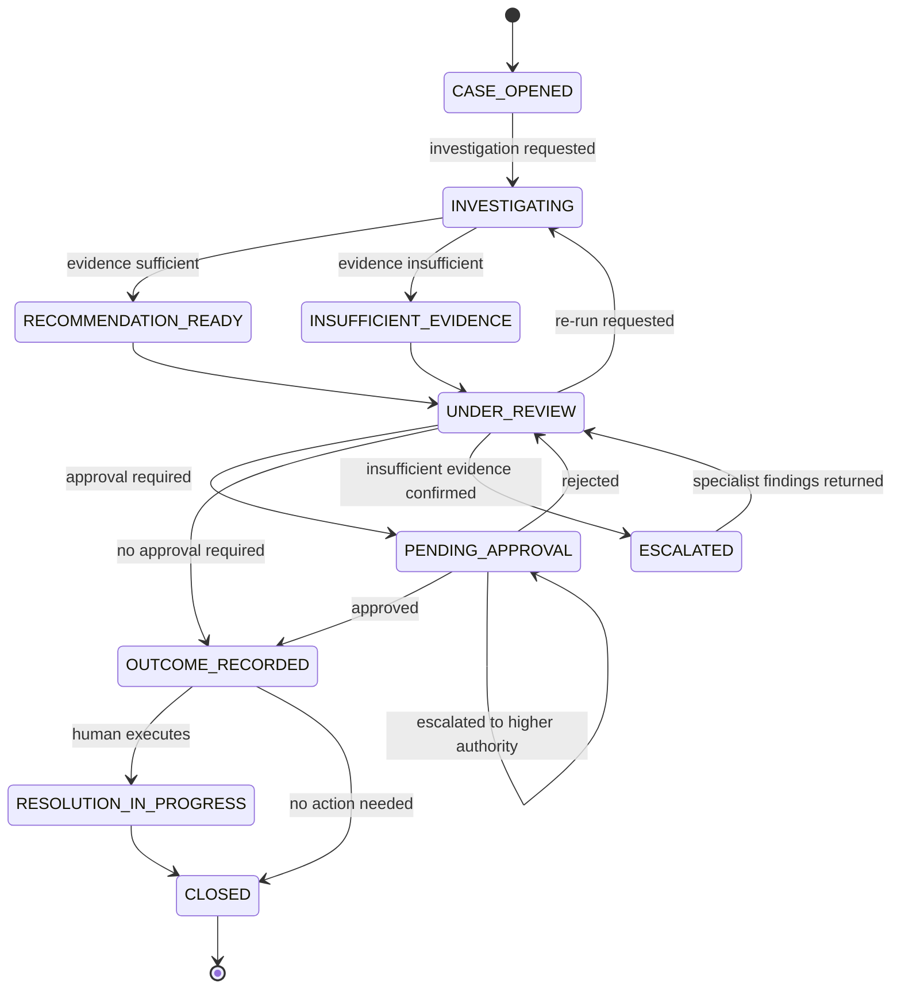

# NorthStar Retail Multi-Agent AI Platform: Stakeholders and Workflows

| Field | Value |
|---|---|
| Document | Stakeholders and Workflows |
| Phase | 02: Stakeholders and Workflows |
| Status | Draft for stakeholder review |
| Source context | [Business Discovery](../01-business-discovery/business-discovery.md) |
| Prepared by | Principal AI Solution Engineer |
| Last updated | 2026-11-08 |

> **What is decided and what is not**
>
> NorthStar Retail is a **fictional company**. This document **introduces no new decisions**. Every **[Decision]** label points to a decision already recorded in the business discovery document (D1–D19). Everything else is a **[Proposal]** for stakeholder approval or an **[Assumption]** still to be verified.
>
> - **[Decision Dn]**: agreed and recorded in Business Discovery §12.
> - **[Proposal]**: a recommended design for this phase; needs approval.
> - **[Assumption]**: believed to be true; not yet verified.
> - **[Open]**: unresolved; tracked in Section 12.
>
> **Terms used:** "CS agent" means a human customer service agent. "Platform" means the investigation platform, whichever architecture is eventually chosen. "Approver" means a human with approval authority for a given action.

---

## 1. Purpose and Scope

This document describes who owns what, and how work and decisions flow through the **initial vertical slice: delayed delivery investigations [Decision D2]**. It covers:

- Stakeholder ownership and a RACI matrix.
- Current-state and future-state investigation workflows.
- Approval boundaries and escalation handoffs.
- Handling of API failures and evidence conflicts.
- Investigation workflow states and audit events.

**Constraints carried over from discovery:**

| Constraint | Source |
|---|---|
| The initial slice is read-only. The platform investigates and recommends; authorized humans perform refunds, reships and order modifications in the owning systems. | **[Decision D11]** |
| Current operational status comes only from OMS, Payment APIs, Inventory APIs and Shipping/Carrier APIs. Snowflake is historical context only. | **[Decision D4, D5]** |
| If an authoritative API is unavailable, the affected status is unknown or unverified. No Snowflake or stale-cache substitution. | **[Decision D15]** |
| Unsupported factual claims are never presented as verified; insufficient evidence is reported and escalated. | **[Decision D12]** |
| Every retrieval enforces the requesting user's permissions as well as service least privilege. | **[Decision D16]** |
| Version metadata is recorded; separation of duties applies where policy requires; the platform is never an approver. | **[Decision D18]** |
| KPI start and stop events follow Business Discovery §8.1. | **[Decision D13]** |
| The workflows are architecture-neutral. Deterministic, single-agent and multi-agent options are still to be compared. | **[Decision D10, D17]** |
| The platform has read-only access to the case management system in the initial slice (Section 6.1). | **[Proposal]**, pending stakeholder confirmation |

---

## 2. Stakeholder Ownership

All role names and team structures are **[Assumption]** for the fictional organization. Data ownership by domain follows **[Decision D4, D5]**; the named owners are **[Assumption]**.

| Code | Stakeholder | Owns | Key decisions they make |
|---|---|---|---|
| SP | VP Customer Experience (Executive Sponsor) | Business outcomes, KPI targets, funding | Approves scope, KPI target and gate thresholds |
| OM | Customer Service Operations Manager | Investigation process, CS agent workflows, baseline measurement, approval policy | Sets resolution and approval policy with Compliance |
| CA | CS Agent | Individual cases: requesting investigations, validating outcomes, recording them | Accepts, amends or rejects recommendations |
| TL | Team Lead / Supervisor (Approver) | Approvals within delegated authority; escalations from CS agents | Approves or rejects resolutions that require approval |
| DO | Domain Data Owners: OMS, Payments, Inventory, Logistics/Carrier | Their system of record, its data and its access scopes | Grants and reviews read access to their APIs |
| DP | Data Platform Owner (Snowflake) | Historical datasets, data quality, dataset access policies | Approves which datasets are used for context |
| IS | Information Security | Access model, secrets handling, threat model | Approves service scopes and user-permission enforcement design |
| PC | Privacy / Compliance / Legal | PII handling, retention, regulatory obligations, audit retention | Approves audit and data retention rules |
| EA | Enterprise Architecture | Integration patterns, architecture standards | Reviews architecture options |
| SE | Principal AI Solution Engineer | Discovery, evaluation design, solution design, documentation | Recommends the production architecture |
| EN | Engineering (AI/ML Engineering, Platform/SRE) | Building, evaluating and running the platform | Operates the platform; handles incidents and defects |

---

## 3. RACI Matrix

**[Proposal]** R = Responsible, A = Accountable (exactly one per row), C = Consulted, I = Informed. Blank means no involvement.

| # | Activity | SP | OM | CA | TL | DO | DP | IS | PC | EA | SE | EN |
|---|---|---|---|---|---|---|---|---|---|---|---|---|
| 1 | Approve scope and KPI target | A | R | | | | | | | C | C | |
| 2 | Approve quality and safety gate thresholds | A | C | | | | | C | C | | R | C |
| 3 | Define resolution and approval policy, including thresholds and separation of duties | I | A/R | C | C | C | | | C | | C | |
| 4 | Measure the current-state baseline | I | A | C | C | | | | | | R | C |
| 5 | Open a case (KPI start) | | I | R | A | | | | | | | |
| 6 | Request an investigation | | | A/R | | | | | | | | |
| 7 | Authorize each retrieval against user and service permissions | | | | | C | C | A | | | | R |
| 8 | Retrieve evidence and produce a recommendation (platform) | | | I | | C | C | | | | C | A/R |
| 9 | Review and validate the outcome | | I | R | A | | | | | | | |
| 10 | Approve a resolution where policy requires it | | C | I | A/R | | | | | | | |
| 11 | Record the validated outcome (KPI stop) | | | R | A | | | | | | | |
| 12 | Execute the approved resolution in the owning system (outside KPI) | | | R | A | I | | | | | | |
| 13 | Escalate insufficient evidence or unresolved conflicts | | I | R | A | C | | | | | | |
| 14 | Grant and periodically review API read access | | | | | A | | C | | | | R |
| 15 | Define the user-permission enforcement model | | | | | C | C | A | C | C | C | R |
| 16 | Maintain Snowflake datasets and freshness | | | | | | A/R | | | | I | I |
| 17 | Define audit events and retention | | C | | | | | C | A | | C | R |
| 18 | Define evaluation scenarios (all three architecture options) | | C | C | | C | | C | | C | A/R | C |
| 19 | Compare architecture options and recommend one | I | C | | | | | C | C | C | A/R | C |
| 20 | Approve the production architecture | | | | | | | C | C | C | R | C |
| 21 | Operate the platform and handle incidents | | I | | | I | | C | | | C | A/R |
| 22 | Review production defects (for example, an unsupported claim) | I | C | | | | | C | | | A | R |

Notes:
- **Row 20:** who is Accountable for the production architecture decision is **[Open]** (Business Discovery Q15), so the A is deliberately left unassigned.
- **Rows 5, 9–13:** the Team Lead is Accountable for case handling on their team **[Assumption]**. Confirm against the real operating model.
- **Row 10:** where separation of duties applies, the approver must be a different person from the CS agent who requested the action **[Decision D18]**.

---

## 4. Current-State Workflow

**[Assumption]** Summarized from Business Discovery §5. The 30-minute baseline **[Assumption, D7]** is taken to cover steps 1–9.

**Current-state issues relevant to the future workflow [Assumption]:** manual lookups across four or more systems, no consistent evidence record, informal escalations and approvals, and inconsistent use of historical context (Business Discovery §6).

### 4.1 Baseline Measurement Limitation

**Limitation [Assumption]:** the KPI stop event (Business Discovery §8.1) requires a validated outcome that includes per-claim evidence provenance (element 2: source system, record identifier, retrieval time and freshness). Today's cases record evidence loosely (Business Discovery §5, step 9), so most current-state cases are unlikely ever to meet that definition. If so, the 30-minute baseline **[Assumption, D7]** cannot be measured against the same stop event as the future state, and a before-and-after comparison on that definition would not be like-for-like.

**Proposed handling [Proposal]**, pending stakeholder agreement and a matching update to Business Discovery §8.1:

1. **Comparable stop event for the time comparison.** Measure both the baseline and the future state from case opening to the first timestamp at which the case records the cause (or "insufficient evidence"), the resolution, the CS agent's review and every required approval: elements 1, 3, 4 and 5 of the §8.1 definition.
2. **Evidence quality measured separately.** Element 2 is assessed through gate G3 (evidence provenance) for the future state only. It is not used to compare times.
3. **Report both definitions** for the future state, so the effect of the evidence requirement on investigation time is visible.
4. **Baseline status stays an assumption** until a representative sample is measured. If the comparable stop event cannot be timestamped from case records (Business Discovery A6), the baseline needs a time-and-motion study instead **[Open]**.

---

## 5. Future-State Workflow (Initial Slice)

**[Proposal]**, constrained by **[Decision D11, D12, D15, D16, D18]**. The workflow does not assume any particular architecture **[Decision D10, D17]**.

### 5.1 Step Detail

| Step | Actor | What happens | Label |
|---|---|---|---|
| F1 | CS agent | Case opened in the case management system. KPI start event. | **[Decision D13]** |
| F2 | CS agent | Requests an investigation for the case. The request carries the CS agent's identity. The platform reads the case details it needs (read-only; Section 6.1). | **[Proposal]** |
| F3 | Platform | Checks every retrieval against both the CS agent's permissions and the platform's service scope. Data the CS agent cannot access is not retrieved or shown. | **[Decision D16]** |
| F4 | Platform | Reads current status from the four systems of record, recording source system, record identifier, retrieval time and the source's as-of time where available. | **[Decision D4, D15]** |
| F5 | Platform | Reads historical context from Snowflake and labels it as historical. It is never used as current status. | **[Decision D5]** |
| F6 | Platform | Applies the API failure rules (Section 8) and conflict rules (Section 9). | **[Proposal]** within **[Decision D15]** |
| F7 | Platform | Produces either a recommendation in which every factual claim cites evidence, or an "insufficient evidence" result listing what is unknown. Records version metadata. | **[Decision D12, D18]** |
| F8 | CS agent | Reviews the result and accepts, amends (with reason) or rejects (with reason). The human decision prevails. | **[Decision D9]**; reasons required **[Proposal]** |
| F9 | Approver | If policy requires approval, approves or rejects. Separation of duties is enforced where policy requires. The platform is never an approver. | **[Decision D9, D18]** |
| F10 | CS agent | Records the validated outcome in the case; the platform does not write to the case (Section 6.1). KPI stop event when the case meets the Business Discovery §8.1 definition. For escalated cases, see Section 7.1. | **[Decision D13]**; recording by CS agent **[Proposal]** |
| F11 | Authorized human | Executes the resolution in the owning system, only after any required approval is recorded. Outside the KPI. | **[Decision D11]**; ordering rule **[Proposal]** |
| F12 | CS agent | Closes the case after execution or customer follow-up. | **[Proposal]** |

---

## 6. Approval Boundaries

The read-only rule is **[Decision D11]**. Approval rules per action follow Business Discovery §9.2 and are **[Proposal]** unless labeled otherwise.

| Action | Performed by | Approval required | Approver | Separation of duties |
|---|---|---|---|---|
| Retrieve current operational data | Platform, within user and service permissions **[Decision D16]** | No | n/a | n/a |
| Retrieve Snowflake historical context | Platform **[Decision D5]** | No | n/a | n/a |
| Produce recommendation or "insufficient evidence" | Platform **[Decision D12]** | No; CS agent review required | n/a | n/a |
| Validate the investigation outcome | CS agent **[Decision D9]** | n/a | n/a | n/a |
| Refund, credit or compensation | Authorized human in owning system **[Decision D11]** | **Yes, for every refund, credit or compensation**, matching Business Discovery §9.2 **[Proposal]**. Amount thresholds decide *which role* approves, not *whether* approval is needed **[Open]** | Role set by amount threshold **[Open]**; team lead for the lowest tier **[Assumption]** | Where policy requires **[Decision D18]**; which actions **[Open]** |
| Reshipment or order modification | Authorized human in owning system **[Decision D11]** | Yes **[Proposal]** | Team lead or designated approver **[Assumption]** | Where policy requires **[Decision D18]** |
| Carrier contact or claim | Human **[Decision D11]** | **[Open]** | **[Open]** | **[Open]** |
| Customer message | CS agent **[Assumption]** | Not an approval step; CS agent sends **[Proposal]** | n/a | n/a |

**Boundary rules [Proposal]:**
1. No resolution is executed before every required approval is recorded.
2. The platform holds no write credentials to systems of record in the initial slice **[Decision D11]**.
3. An approver cannot approve their own request where separation of duties applies **[Decision D18]**.
4. If a request exceeds the approver's authority, it is escalated to the next authority level (Section 7) rather than approved.

### 6.1 Case Management System Access

**[Proposal]**, pending confirmation by the case management system owner (**[Assumption]**: the CS Operations Manager or a case-system product owner), Information Security and Privacy/Compliance. Business Discovery D11 makes the platform read-only for systems of record but does not mention the case management system; this proposal extends the same read-only stance to it for the initial slice.

| Aspect | Proposed rule |
|---|---|
| Access | Read-only. The platform holds no credentials that can create, update or close cases, or add notes or attachments. |
| What may be read | Only fields the investigation needs: case ID, linked order ID, contact reason, case status and the timestamps needed for the KPI events. Free-text customer notes are read only if needed, treated as unverified data and never as instructions. |
| Permissions | Each read is checked against the requesting CS agent's permissions as well as the platform's service scope **[Decision D16]**. |
| Who writes to the case | The CS agent records the validated outcome, approvals reference and any escalation. The platform output stays in the platform and its audit log; the CS agent may copy it into the case. |
| KPI timestamps | Read from the case record, so start and stop events come from the system the CS agent uses, not from the platform. |
| Future write access | Attaching recommendations or updating case status from the platform needs separate approval and design, in the same way as D11 requires for systems of record. |

**Trade-off [Assumption]:** manual recording by the CS agent stays inside the measured time, so it may limit how far investigation time falls.

---

## 7. Escalation Handoffs

The destination teams below are **[Assumption]**. The overall escalation path for insufficient evidence is **[Open]** (Business Discovery Q18).

| Trigger | From | To | Platform behavior | Label |
|---|---|---|---|---|
| Insufficient evidence to determine the cause | CS agent | Specialist team for the missing domain (for example, logistics) | Lists what is unknown and why; makes no guess | **[Decision D12]**; destination **[Open]** |
| Conflict between authoritative sources that blocks a conclusion | CS agent | Owners of the conflicting domains | Shows both values with provenance | **[Proposal]** |
| Authoritative API unavailable for a status needed to conclude | CS agent | Retry later, or the domain's operations team if prolonged | Marks status unknown; no substitution | **[Decision D15]**; routing **[Proposal]** |
| Payment hold or possible fraud indicator | CS agent | Payments or fraud team | Reports the hold as evidence; does not assess fraud | **[Proposal]**; fraud adjudication out of scope |
| Request exceeds approver's authority | Approver | Next authority level | n/a | **[Proposal]** |
| Approval rejected | Approver | Back to CS agent for a revised resolution | n/a | **[Proposal]** |
| CS agent lacks permission for needed data | CS agent | Team lead to reassign | Reports "not accessible to requesting user"; reveals no restricted data | **[Decision D16]**; routing **[Proposal]** |
| Suspected platform defect (for example, unsupported claim found) | CS agent or reviewer | Engineering (EN) and Solution Engineer (SE) | Logged and reviewed as a defect | **[Decision D12]**; routing **[Proposal]** |

**Handoff package [Proposal]:** every escalation carries the case ID, the evidence gathered with provenance and freshness, the list of unknown or conflicting items, the platform output and its version metadata, the CS agent's notes, and the reason for escalation. The receiving team should not need to repeat lookups already done.

### 7.1 Escalation and the KPI Clock

**Problem:** Business Discovery §8.1 (element 1) accepts "insufficient evidence together with the escalation taken" as a validated outcome. Read literally, sending an escalation stops the KPI clock, so a case could appear fast simply by being escalated while the real investigation continues elsewhere.

**Proposed rule [Proposal]**, which requires amending Business Discovery §8.1 and D13:

- **The clock keeps running through an escalation.** For an escalated case, the KPI stop event is the first timestamp at which a validated outcome is recorded *after* the receiving team has returned its findings: either a determined cause, or the receiving team's confirmation that the cause cannot be determined. Sending the escalation does not stop the clock.
- **Escalated cases stay in the KPI population.** They are never removed from the measured cases or reported only as a separate group; the median and P90 include them. They are also reported as a separate cohort for visibility.

**Safeguards until the amendment is agreed [Proposal]:** D13 applies as written, and:

1. Escalated cases are reported as a separate cohort and cannot count toward meeting the 10-minute target on their own.
2. Time from case opening to the receiving team's outcome is tracked for every escalated case.
3. The insufficient-evidence and escalation rate must not exceed the measured baseline rate. This would be an additional quality gate alongside Business Discovery §8.2; the threshold is **[Proposal]**.
4. An escalation counts as "taken" only when the handoff package is complete and the receiving team has acknowledged it.

---

## 8. API Failure Handling

All behaviors operate under **[Decision D15]**: an unavailable authoritative source means the affected current status is unknown or unverified, and neither Snowflake nor stale cached data may stand in for it. Specific retry counts and freshness limits are **[Open]**.

| Failure | Example | Platform behavior | Label |
|---|---|---|---|
| Unavailable or timed out | Carrier API returns errors or times out | Mark affected status "unknown"; continue with other sources; state the gap in the output | **[Decision D15]** |
| Rate limited | Carrier API throttles requests | Bounded retry with back-off; if still limited, treat as unavailable | **[Proposal]** |
| Partial or incomplete data | Order returned without line items | Mark the missing elements "unverified"; do not infer them | **[Decision D15]** |
| Stale data | Source as-of time older than the freshness limit for that domain | Show as "unverified" with its as-of time; never present as current | **[Decision D15]**; limits **[Open]** |
| Service authorization failure | Platform credential rejected | Treat as unavailable; raise an operational alert | **[Proposal]** |
| User permission denied | CS agent not entitled to payment details | Do not retrieve; report "not accessible to requesting user" | **[Decision D16]** |
| Malformed or unexpected response | Schema mismatch | Discard the response; treat as unavailable; alert Engineering | **[Proposal]** |
| Snowflake unavailable | Warehouse unreachable | Continue without historical context and say so; this does not affect current-status findings | **[Proposal]** |

**Effect on the outcome [Proposal]:** if an unknown status is needed to determine the cause, the platform reports "insufficient evidence" (Section 7). If the cause can be shown from the available sources, the recommendation still lists the unknown items.

---

## 9. Evidence Conflict Handling

| Conflict | Rule | Outcome | Label |
|---|---|---|---|
| Operational system vs Snowflake | The operational system wins | Use operational value; record the disagreement as an observation | **[Decision D5]**; observation **[Proposal]** |
| Between two authoritative systems (for example, OMS says shipped, carrier has no pickup scan) | Do not silently pick one. The mismatch may itself be the cause of the delay. | Report both values with provenance. If the conflict prevents a conclusion, report "insufficient evidence" and escalate | **[Proposal]** |
| Same system, different reads over time | Use the most recent read; keep the earlier one in the audit trail | Show the as-of time | **[Proposal]** |
| Structured data vs free text (carrier notes, customer statements) | Structured system-of-record data is authoritative; free text is unverified context and is treated as data, never as instructions | Free text may be quoted but not used as a verified claim | **[Proposal]** |
| Multiple shipments or carriers on one order | Evaluate each shipment separately | Per-shipment findings in one recommendation | **[Proposal]** |
| Platform recommendation vs CS agent judgment | The human decision prevails | Record the amendment or rejection and the reason | **[Decision D9]**; reason **[Proposal]** |

---

## 10. Workflow States

**[Proposal]** Investigation states for the initial slice. The KPI mapping follows **[Decision D13]**.

| State | Meaning | KPI |
|---|---|---|
| CASE_OPENED | Case created in the case management system | ▶ Start event |
| INVESTIGATING | Platform is retrieving and analyzing evidence | Inside |
| RECOMMENDATION_READY | Recommendation with cited evidence available | Inside |
| INSUFFICIENT_EVIDENCE | Platform could not support a conclusion; unknowns listed | Inside |
| UNDER_REVIEW | CS agent is reviewing, amending or rejecting | Inside |
| PENDING_APPROVAL | Waiting for a required human approval | Inside (approval wait counted) |
| ESCALATED | Handoff package sent and acknowledged; receiving team investigating | Inside; the clock keeps running until findings are returned and the outcome is recorded (Section 7.1) |
| OUTCOME_RECORDED | Validated outcome recorded per Business Discovery §8.1 | ■ Stop event |
| RESOLUTION_IN_PROGRESS | Authorized human executing the resolution in the owning system | Outside |
| CLOSED | Case closed | Outside |

**Transition rules [Proposal]:**
- OUTCOME_RECORDED cannot be reached from PENDING_APPROVAL without an approval event, or from UNDER_REVIEW if approval is required.
- RESOLUTION_IN_PROGRESS cannot be entered until every required approval is recorded.
- ESCALATED cannot move directly to OUTCOME_RECORDED. The receiving team's findings return to UNDER_REVIEW, so the escalation itself never stops the KPI clock (Section 7.1).

---

## 11. Audit Events

Audit trails are **[Decision D9]**; version metadata is **[Decision D18]**; provenance and freshness are **[Decision D15]**. The event catalog below is **[Proposal]**. Retention periods are **[Open]** (Business Discovery Q20); tamper evidence is **[Assumption]** (Business Discovery §9.3).

**Fields on every event [Proposal]:** event ID, event type, timestamp, case ID, correlation ID, actor (user ID or service identity), and outcome (success or failure). Secrets and cardholder data are never logged; PII is minimized.

| Event | Emitted when | Additional required fields |
|---|---|---|
| `case.opened` | Case created (KPI start) | Case source channel |
| `case.read` | Platform reads case details (read-only) | Fields read, requesting user |
| `investigation.requested` | CS agent requests investigation | Requesting user |
| `authorization.checked` | Each retrieval is authorized | User permission result, service scope result, resource |
| `authorization.denied` | User or service is not permitted | Which check failed, resource (without restricted content) |
| `evidence.retrieved` | Data read from a system of record | Source system, record ID, retrieval time, source as-of time |
| `source.unavailable` | Timeout, error, rate limit or malformed response | Source system, failure class, affected status marked unknown |
| `evidence.stale` | Data older than the freshness limit | Source system, as-of time, limit applied |
| `history.retrieved` | Snowflake context read | Dataset, query reference, data as-of time |
| `evidence.conflict_detected` | Two sources disagree | Sources, values, rule applied (Section 9) |
| `output.validation_failed` | A claim without evidence is caught before display | Claim reference, action taken |
| `recommendation.generated` | Recommendation produced | Claims with citations; version metadata: model, prompt, configuration and tool versions, or rule set version |
| `recommendation.insufficient_evidence` | Insufficient-evidence result produced | Unknown items; version metadata |
| `review.accepted` / `review.amended` / `review.rejected` | CS agent decision | Reviewer, reason (for amend or reject), changes made |
| `approval.requested` | Approval needed | Requester, action, amount if any, policy reference |
| `approval.granted` / `approval.rejected` | Approver decision | Approver, separation-of-duties check result, reason |
| `approval.sod_blocked` | Self-approval attempted where SoD applies | Requester, attempted approver |
| `escalation.created` | Handoff sent | Destination, trigger, handoff package reference |
| `escalation.acknowledged` | Receiving team accepts the handoff | Receiving team, acknowledged by |
| `escalation.findings_returned` | Receiving team returns findings (clock still running) | Findings summary, cause determined or confirmed undeterminable |
| `outcome.recorded` | Validated outcome recorded (KPI stop) | Outcome type (cause found or insufficient evidence), recorded by |
| `resolution.executed` | Human executes the resolution (outside KPI) | Executor, owning system, reference, linked approval ID |
| `case.closed` | Case closed | Closed by |
| `defect.reported` | Production defect raised | Defect type, linked recommendation ID |

`resolution.executed` happens in the owning systems, which the platform does not write to **[Decision D11]**. Under the read-only case access proposal (Section 6.1), the platform would capture it by reading the execution reference the CS agent records in the case **[Proposal]**.

---

## 12. Open Questions

1. Which teams receive each escalation type, and in what order? (Business Discovery Q18)
2. What are the approval thresholds by role, and which actions need separation of duties? (Q4, Q19)
3. What are the freshness limits per domain (order, payment, inventory, tracking)?
4. What retry and timeout limits apply to each operational API?
5. Do the case-system owner, Information Security and Privacy/Compliance confirm read-only case management access for the initial slice (Section 6.1)?
6. Will stakeholders amend Business Discovery §8.1 and D13 so that escalation does not stop the KPI clock (Section 7.1), and adopt the comparable stop event for the baseline (Section 4.1)?
7. Who is Accountable for approving the production architecture? (Q15)
8. Is a customer update part of the validated outcome or a later step? (Q17)

---

## 13. Consistency Check Against Business Discovery

One focused check was performed: does every workflow, boundary and state in this document agree with the discovery decisions (D1–D19)?

### 13.1 Alignment

| Discovery decision | Reflected in | Result |
|---|---|---|
| D2 Delayed delivery first | §1, §5 | Aligned |
| D4, D5 Systems of record; Snowflake historical only | §5 F4–F5, §8, §9 | Aligned |
| D9 Evidence, least privilege, audit, approvals | §5, §6, §11 | Aligned |
| D10, D17 Architecture-neutral comparison | §1, §5 | Aligned; no workflow step assumes an architecture |
| D11 Read-only slice | §5 F11, §6, §8, §11 | Aligned; no platform write path to systems of record |
| D12 Insufficient evidence, no unsupported claims | §5 F7, §7, §11 | Aligned |
| D13 KPI start and stop | §4, §5, §7.1, §10 | Aligned for the start event and non-escalated cases. §4.1 (baseline) and §7.1 (escalation) propose amendments to §8.1 that need stakeholder agreement |
| D15 Unavailable means unknown | §8, §9 | Aligned |
| D16 User permissions per retrieval | §5 F3, §7, §8, §11 | Aligned |
| D18 Version metadata, SoD, platform never approves | §5 F9, §6, §11 | Aligned |

### 13.2 Observations and How They Are Handled

- **C1. Baseline measurability (discovery review N1).** Recorded as a limitation in Section 4.1, with a proposed comparable stop event. Still needs stakeholder agreement and a matching update to Discovery §8.1.
- **C2. Escalation could stop the KPI clock early.** Section 7.1 proposes that the clock keeps running through an escalation, and the workflow states in Section 10 enforce this. This departs from the literal wording of Discovery §8.1 and D13, so it needs a recorded amendment; interim safeguards apply until then.
- **C3. Refund approval wording (discovery review N5).** Section 6 now matches Discovery §9.2: every refund, credit or compensation needs approval, and thresholds decide only which role approves. Discovery §5 step 8 ("above a threshold") describes current practice **[Assumption]**, not the future rule; tidying that wording is a discovery-document change.
- **C4. Case system access.** Section 6.1 proposes read-only access for the initial slice, pending stakeholder confirmation (Open question 5).
