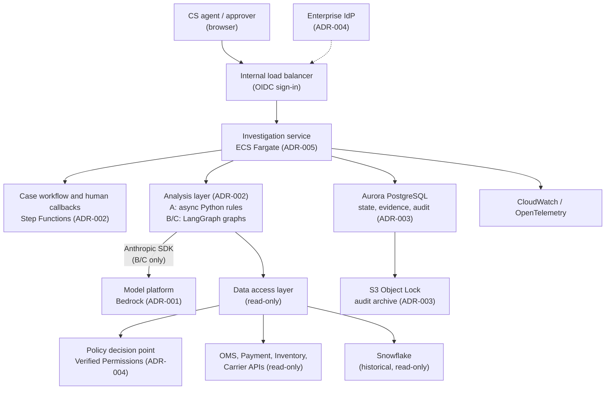

# NorthStar Retail Multi-Agent AI Platform: Technology Selection

| Field | Value |
|---|---|
| Document | Technology Selection and Architecture Decision Records |
| Module / Step | Module 1, Step 1.6 |
| Status | Draft for stakeholder review; all ADRs **Proposed** |
| Source context | Business Discovery (BD), Stakeholders and Workflows (WF), Functional Requirements (FR), Non-Functional Requirements (NFR), Architecture Alternatives (AA) |
| Prepared by | Principal AI Solution Engineer |
| Last updated | 2026-11-08 |

> **How to read this document**
>
> NorthStar Retail is **fictional**. This document and its ADRs **introduce no decisions and record no approvals**. Every ADR has status **Proposed** until the architecture approval authority, still **[Open]** (BD Q15), accepts it. No benchmark has been run; nothing here reports measured results. Labels follow BD: **[Decision Dn]**, **[Proposal]**, **[Assumption]**, **[Open]**, **TBD**. Pending stakeholder proposals **PP-1 to PP-4** (FR §2.2) remain **not approved**.

---

## 1. Purpose and Scope

Select candidate technologies for the shared control plane and the three architecture alternatives (AA §2–3), so the fair benchmark (AA §8) and the initial release can be built. Each significant choice is recorded as an ADR:

| ADR | Topic | Proposed choice | Status |
|---|---|---|---|
| [ADR-001](adrs/ADR-001-ai-model-platform.md) | AI model platform | Claude models through **Amazon Bedrock**, behind a provider-neutral interface; Claude Platform on AWS as the evaluated alternative | Proposed |
| [ADR-002](adrs/ADR-002-workflow-and-agent-orchestration.md) | Workflow and agent orchestration | **AWS Step Functions (Standard)** for case workflows and human callbacks; **LangGraph** as the candidate for stateful AI orchestration in B and C (planned hands-on implementation); **async Python** for the deterministic baseline A; **Anthropic SDK** for model API access only, not as a replacement for LangGraph | Proposed |
| [ADR-003](adrs/ADR-003-investigation-state-storage.md) | Investigation state storage | **Amazon Aurora PostgreSQL** for state, evidence, results and audit; **S3 Object Lock** archive for tamper-evident audit retention | Proposed |
| [ADR-004](adrs/ADR-004-workforce-identity-and-authorization.md) | Workforce identity and authorization | Federate the **existing enterprise IdP** via OIDC; **Amazon Verified Permissions** as the policy decision point; user context forwarded to systems of record where supported | Proposed |
| [ADR-005](adrs/ADR-005-aws-deployment-and-terraform.md) | AWS deployment and Terraform | **Multi-account AWS, single region, Multi-AZ, ECS Fargate**, private networking; all infrastructure in **Terraform** with policy checks in CI | Proposed |

**Not decided in this step:** UI framework, CI system details, approver notification channel and the production architecture itself (AA §8.5). These are **[Open]**. Python for the analysis layer follows from ADR-002 and is **[Proposal]**; the language for other components is **[Open]**.

---

## 2. Platform Direction

| Item | Status |
|---|---|
| AWS as the cloud platform and Terraform for infrastructure as code | Specified in the Step 1.6 request. **Not yet recorded as a decision** in BD §12. **[Open]**: the user to confirm and record |
| AWS region | TBD; depends on data residency (BD Q12) |
| Snowflake | Already in use for historical analytics **[Decision D5]**; accessed read-only from AWS |

---

## 3. Selection Principles

All **[Proposal]**, derived from existing decisions:

1. **Safety lives in the shared control plane** (AA §2). Technology for authorization, data access, validation, approval and audit is chosen for determinism and auditability, not for AI capability.
2. **Read-only by construction** **[Decision D11]**. No selected service is given write credentials to systems of record; Terraform policy checks enforce this.
3. **The platform is never an approver** **[Decision D18]**. Approval is a human action recorded by the workflow service, never by a model.
4. **User permissions on every retrieval** **[Decision D16]**. Authorization decisions are made by a policy service called by the data access layer, never by a model.
5. **Architecture-neutral** **[Decision D10, D17]**. Every selection supports A, B and C. No selection requires a fixed number of agents.
6. **Managed services where they reduce operational load** (AA §7 complexity proxies), provided they keep data and control inside NorthStar's AWS accounts.
7. **Replaceable AI provider.** The analysis layer talks to models through a narrow internal interface so the model or provider can change without touching the control plane.
8. **Accept only after validation.** Each ADR lists validation requirements; acceptance needs those results and the approval authority's sign-off.

---

## 4. Reference Architecture

### 4.1 Shared Control Plane Mapping

| AA §2 component | Proposed technology | ADR |
|---|---|---|
| Identity and authorization gateway | Enterprise IdP via OIDC; Amazon Verified Permissions | ADR-004 |
| Read-only data access layer | Service module in ECS Fargate; read-only credentials in Secrets Manager; client-side rate limits, retries and circuit breakers per NFR §8 | ADR-005, ADR-004 |
| Evidence store | Aurora PostgreSQL | ADR-003 |
| Output validator | Deterministic code in the investigation service | ADR-002 |
| Workflow, review and approval | Step Functions Standard with task-token callbacks for human steps (never inside LangGraph) | ADR-002 |
| Analysis layer (not part of the control plane; differs by alternative) | A: async Python; B and C: LangGraph, calling Claude through the Anthropic SDK | ADR-002, ADR-001 |
| Audit and telemetry | Aurora append-only audit table, S3 Object Lock archive, CloudWatch, OpenTelemetry | ADR-003, ADR-005 |
| Budget guard | Per-run token counter in the analysis layer; AWS Budgets and Cost Anomaly Detection | ADR-001, ADR-005 |

---

## 5. Cross-ADR Validation

No ADR moves from Proposed to Accepted until its validation requirements pass. Together they reuse the existing tests:

| Validation | Tests | ADRs |
|---|---|---|
| Read-only and approval boundaries hold | NT-10 (credential review), TS-N12, TS-N13, TS-N14, TS-N23 | 001, 002, 004, 005 |
| User permissions enforced on every retrieval | TS-N01, TS-N02, gate G6 | 004 |
| Unsupported or historical-as-current claims blocked | Gates G1, G4; TS-N04, TS-N11 | 001, 002 |
| Audit complete and fail-closed | Gate G7; NT-04 | 003 |
| Latency, reliability, scale | NT-03, NT-05, NT-07, NT-09 | 001, 002, 003, 005 |
| Cost tracking and budgets | NT-13, NT-14, NT-15 | 001, 005 |
| Architecture benchmark | AA §8 for A, B and C | 001, 002 |

---

## 6. Requirements Traceability

| Requirement | Addressed in |
|---|---|
| D5 Snowflake historical only; FR-HIST-01 to 03 | ADR-004 (read-only Snowflake role), ADR-005 (network path) |
| D9, D18 human approval, SoD, platform never approves; FR-APR-01 to 06 | ADR-002, ADR-004 |
| D10, D17 fair comparison; AA §8 | ADR-001, ADR-002 |
| D11 read-only; FR-RO-01 to 04; NFR-SEC-02 | ADR-004, ADR-005 |
| D12 evidence-supported claims; FR-EVD-02 | ADR-001, ADR-002 |
| D15 unknown when unavailable; NFR §4 | ADR-001, ADR-002, ADR-005 |
| D16 user permissions; FR-AUTH-01 to 03; NFR-SEC-01 | ADR-004 |
| FR-REC-04 version metadata | ADR-001, ADR-003 |
| FR-AUD-01 to 05; NFR-REL-02; NFR-PRV-04 | ADR-003 |
| FR-WFS-01; FR-ESC-01 to 04; PP-2 | ADR-002, ADR-003 |
| NFR-AVL, NFR-REL, NFR-SCL, NFR-RTY | ADR-002, ADR-003, ADR-005 |
| NFR-SEC, NFR-PRV, NFR-OBS | ADR-004, ADR-005 |
| NFR-FIN-01 to 09 | ADR-001, ADR-005 |

---

## 7. Open Questions

| Question | Affects | Source |
|---|---|---|
| Who accepts ADRs and the production architecture? | All ADRs | BD Q15 |
| Confirm and record AWS and Terraform as decisions | ADR-005 | §2 |
| AWS region and data residency | ADR-001, ADR-005 | BD Q12 |
| Which enterprise IdP NorthStar uses | ADR-004 | New |
| Do systems of record accept delegated user tokens? | ADR-004 | BD Q6 |
| Model availability and pricing on the chosen platform and region | ADR-001 | NFR §14 |
| Audit retention period | ADR-003 | BD Q20 |
| PP-1 (case system access) and PP-2 (escalation clock) | ADR-002, ADR-004 | FR §2.2 |
| How the outcome-recorded state is detected | ADR-002 | FR-WFS-01 AC4 |
| Repository visibility before infrastructure code is added (the repository is public) | ADR-005 | New |
